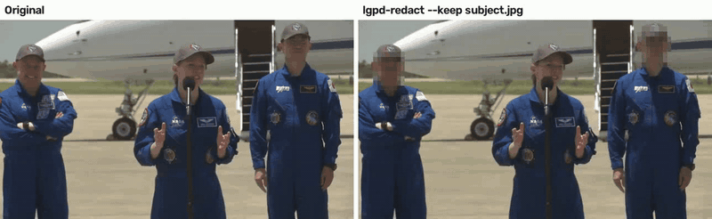
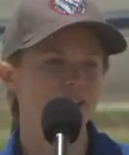
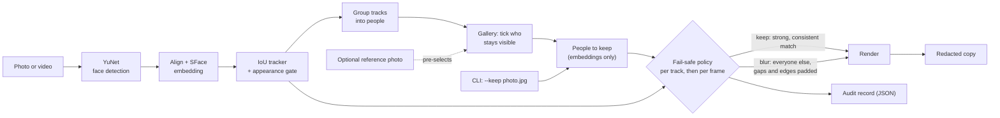

# LGPD Face Redactor

Blur every face in a video except the data subject's, so CCTV and event footage can be
handed over for an LGPD/GDPR access request without exposing anyone else. Runs locally,
fails safe and writes an audit record of every decision.

[](https://github.com/gcfialho/lgpd-face-redactor/actions/workflows/ci.yml)

[](LICENSE)





**Reference photo** (left) taken from a *different* scene of the same video, so the match
is real and not a frame compared with itself. Generated by
[`demo/make_demo.py`](demo/make_demo.py) from public-domain footage of NASA's SpaceX
Crew-11 arriving at Kennedy Space Center (NASA Image and Video Library).
<br clear="left">

## Highlights

- **Fills a real gap.** Open-source tools such as deface and EgoBlur blur *every* face.
  Keeping one person visible usually means commercial software and picking faces by hand.
  Here you upload the footage, see everyone it contains grouped **by person**, and tick
  who stays visible. A reference photo can pre-select the data subject.
- **Fail-safe by design.** A face stays visible only when it matches the reference
  consistently across its whole track, and frame by frame. Everything else is blurred,
  including the frames around brief detector misses.
- **Privacy built in.** Processing is local; the web app loads nothing from third parties.
  Each job lives in a private temporary folder that is deleted on request or after one
  hour. No biometric data goes into the audit record, and audio is dropped unless you ask
  to keep it.
- **Accountable.** Every run writes a JSON audit record: input and output hashes, model
  hashes, settings, how many people were kept, and the decision and reason for each
  tracked person.
- **Measured, not assumed.** Evaluation scripts report detector recall on WIDER FACE (a
  missed face is a leak) and calibrate the match threshold on LFW by false accept rate.

## Quickstart

Requires [uv](https://docs.astral.sh/uv/). The model weights (YuNet 232 KB, SFace 39 MB)
are downloaded on first use from the OpenCV Zoo and verified by SHA-256.

**Web app.** Upload a photo or video, tick who stays visible, download the result.

```bash
git clone https://github.com/gcfialho/lgpd-face-redactor.git
cd lgpd-face-redactor
uv sync --extra web
uv run lgpd-redact-web                  # http://127.0.0.1:8000
```

The same app runs in Docker, with the model weights baked into the image so it works offline:

```bash
docker build -t lgpd-face-redactor .
docker run --rm -p 127.0.0.1:8000:8000 lgpd-face-redactor   # published on localhost only
```

**Command line.** For batch jobs and scripts:

```bash
uv run lgpd-redact footage.mp4 --keep subject.jpg -o redacted.mp4   # keep the person in subject.jpg
uv run lgpd-redact footage.mp4 -o redacted.mp4                      # blur every face
```

Each CLI run also writes `redacted.mp4.audit.json`. Options: `--keep` several times (several
photos or people), `--style pixelate|blur|box`, `--threshold`, `--keep-audio`.

> Run it on the machine or private server of whoever handles the request. A public upload
> site would turn its operator into a processor of other people's biometric data, which is
> what this tool exists to avoid.

## How it works



`analyze` decodes the video once to detect, embed and track every face. `assess` compares
every sighting with the people to keep and plans the blur; it is cheap, so changing the
selection does not re-process the video. `render` decodes the video a second time and
applies the plan. The CLI and the web app share all three steps.

**Grouping by person** is deliberately conservative. Merging two different people would
let one click reveal a stranger, while splitting one person only costs a second tick. Tracks
are merged by average-linkage on their mean embeddings, with a threshold stricter than the
verification point, and two tracks that appear in the same frame are never merged.

| Module | Responsibility |
|---|---|
| `vision.py` | YuNet detector and SFace embedder (OpenCV DNN), reference photo enrollment |
| `tracking.py` | Greedy IoU tracker. An appearance gate starts a new track when a different face appears in the same place. |
| `policy.py` | Keep/blur decision per track, frame-level floor, gap filling and padding |
| `people.py` | Groups tracks into people for the gallery; never merges tracks that co-occur |
| `pipeline.py` | `analyze → assess → render`, shared by the CLI and the web app |
| `audit.py` | Audit record without biometric data |
| `web/` | FastAPI app: upload, background analysis with progress, gallery, render, download, delete |
| `eval/` | WIDER FACE recall and LFW threshold calibration |

## Results

Measured by the [`Evaluate`](.github/workflows/evaluate.yml) workflow. Raw numbers are in
[`eval/results/`](eval/results/).

**Recognition: LFW, 6,000 standard pairs, 10-fold protocol.** No pair failed detection
or alignment.

| Metric | Value |
|---|---|
| Verification accuracy | **99.38% ± 0.37%** |
| ROC AUC | 0.9988 |
| Threshold for 1% false accepts | 0.289 (true accept rate 99.4%) |
| Threshold for 0.1% false accepts | 0.352 (true accept rate 98.7%) |

The default track threshold (0.42) sits above the 0.1% false accept point. It deliberately
trades some missed matches, which only blur the subject, for fewer strangers left visible.

**Detection: WIDER FACE validation, 3,226 images, 39,112 faces.** A face counts as found
if a detection covers it with IoU ≥ 0.5, or covers 80% of it after the redactor's box
expansion.

| Face size (shorter side) | Faces | Recall |
|---|---|---|
| ≥ 64 px | 3,540 | **91.8%** |
| 32–64 px | 6,056 | 87.9% |
| 16–32 px | 10,165 | 77.8% |
| < 16 px | 19,351 | 38.8% |
| **16 px and up** | 19,761 | **83.4%** |

WIDER FACE is deliberately hard: crowds, occlusion and extreme poses, and half of its faces
are under 16 px. Faces of 32 px or more were found 88–92% of the time, so even in
favourable footage the detector is not perfect. A missed face is the main residual risk,
which is why every output should go through human review before release (see
Limitations).

## Methodology

**Why errors are asymmetric.** Blurring the subject by mistake makes the copy less useful.
Leaving a third party visible is a data leak. Every default leans toward the first.

- **Detector:** YuNet with a low score threshold (0.6). A false box only blurs some
  background; a missed face exposes someone. Boxes are expanded by 35%, because hair, ears
  and the chin identify people too.
- **Recognition:** SFace embeddings of aligned faces, compared by cosine similarity with
  every reference. OpenCV's reported LFW operating point is 0.363. The default here is
  stricter (0.42), and `eval/lfw_verification.py` reports the threshold for a given false
  accept rate so it can be calibrated.
- **Track-level decision:** to keep a track, its median similarity must clear the
  threshold, at least 60% of its frames must clear it (frames that could not be compared
  count against), and it must span at least 5 frames. A glimpse is not enough evidence.
- **Frame-level floor:** inside a kept track, a frame whose similarity drops below 0.36, or
  cannot be computed, is still blurred. This contains tracker identity switches. A test
  covers a stranger stepping into the subject's position.
- **Gap filling:** for blurred tracks, boxes are interpolated across missed detections and
  held 3 frames before and after each appearance.
- **Rendering:** coarse pixelation by default, Gaussian blur, or a solid box (strongest).

## Project structure

```
├── src/lgpd_face_redactor/
│   ├── cli.py            # lgpd-redact
│   ├── pipeline.py       # analyze → assess → render
│   ├── policy.py         # fail-safe decisions
│   ├── tracking.py       # IoU tracker with appearance gate
│   ├── matching.py       # reference gallery, cosine similarity
│   ├── vision.py         # YuNet + SFace
│   ├── models.py         # pinned, checksum-verified weights
│   ├── media.py          # video/image I/O, optional audio mux
│   ├── render.py         # pixelate / blur / box
│   ├── people.py         # tracks → people
│   ├── audit.py          # audit record
│   └── web/              # FastAPI app, templates, static assets
├── eval/                 # WIDER FACE recall, LFW calibration
└── tests/                # scripted-face scenarios, OpenCV integration, real-model smoke tests
```

## Testing

```bash
uv run pytest            # all tests; the real-model ones download the weights once
uv run pytest -m "not models"
```

The core tests use scripted detections and identity-coded embeddings, so they cover the
scenarios that matter without any real faces:
- the subject stays visible and a stranger is blurred;
- a stranger stays blurred through detector misses;
- a brief glimpse of the subject is not trusted;
- an identity switch is caught;
- faces that cannot be aligned are blurred;
- several people can be kept;
- a person who leaves and returns is one card, and co-occurring faces are never merged;
- the web flow covers upload, gallery, selection, rendering, download, deletion and privacy headers.

## Limitations & roadmap

**Limitations**
- Only faces are redacted. Clothing, tattoos, voices, licence plates and on-screen text can
  also identify people; review the output before releasing it.
- Detection recall is about 92% for large faces and drops sharply below 16 px (38.8% on
  WIDER FACE). Distant or tiny faces in wide CCTV shots can be missed. Review every
  output, or use `--style box` and crop the area of interest before redacting.
- The output codec is `mp4v`. Some browsers need H.264; re-encode with ffmpeg if needed.
- This tool supports a controller's process. It is not legal advice, and a human should
  review every release.

**Roadmap**
- Tiled or upscaled detection for small faces, which is the weakest bucket above.
- Body-level redaction (person segmentation) and licence plates.
- A stronger tracker (Kalman filter with appearance features) and H.264 output.
- An end-to-end leakage benchmark on consented multi-person footage.

**Origin.** This project started as a webcam face-recognition exercise for the Computer
Vision course in Computer Engineering at UERJ (2023). It was rebuilt from scratch with
modern models, a fail-safe policy and an evaluation suite.

## Author

**Guilherme Fialho** · Machine Learning Engineer (GenAI/LLMs) and Data Engineer ·
[LinkedIn](https://www.linkedin.com/in/guilherme-cagide-fialho/) · [GitHub](https://github.com/gcfialho)
